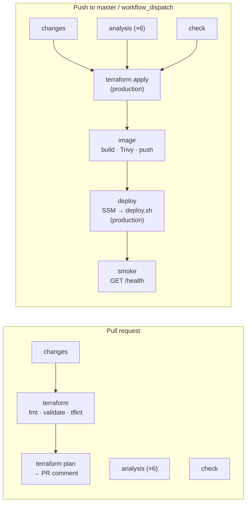

# Deployment pipeline

How a change gets from a pull request to production, what stops it on the way, what has to
be set up on GitHub for it to run, and how to roll back. Everything is one workflow,
[`.github/workflows/ci.yml`](../.github/workflows/ci.yml) (**CI/CD**), so the order of the
stages is the order of its jobs and nothing is deployed that did not pass the same run's
checks. There is no SSH anywhere and no AWS key in GitHub: every AWS call is made with
short-lived credentials obtained through GitHub's OIDC token, and the host is reached only
through SSM Run Command.

The infrastructure it deploys to is described in [`infra/app/README.md`](../infra/app/README.md),
the roles it assumes in [`infra/bootstrap/README.md`](../infra/bootstrap/README.md), and the
static and security analysis it runs in [`static-analysis.md`](./static-analysis.md).

## The pipeline



| Job | Runs on | Does | Gate (fails the run) |
|---|---|---|---|
| `changes` | every run | Lists the changed paths; decides whether the Terraform jobs run | — |
| `analysis (…)` | every run but a rollback | ruff, Semgrep, gitleaks, pip-audit, Trivy `fs`, zizmor; SARIF to code scanning | HIGH/CRITICAL, see [static-analysis.md](./static-analysis.md) |
| `check` | every run but a rollback | Lint, format, the test suite twice, the pipeline smoke and evaluations | Any failure or skipped test |
| `terraform (fmt, validate, tflint)` | PRs touching `infra/**` or the workflow | `terraform fmt -check`, `validate` and tflint on **both** roots, no cloud access | Any finding |
| `terraform plan` | PRs touching `infra/app/**` | Plan of `infra/app` against the real state, posted as one PR comment that later pushes update | Plan error |
| `terraform apply` | master, when `infra/app/**` changed; every dispatch unless `skip_apply` | Plan and apply of `infra/app`, plan printed to the job summary | Apply error |
| `image (build, scan, push)` | master and dispatch, unless `image_tag` is given | Builds the image (`linux/amd64`, `APP_VERSION=<sha>`), Trivy scan, then pushes `:<sha>` and `:latest` | HIGH/CRITICAL with a fix available: **nothing is pushed** |
| `deploy` | master and dispatch | Checks the image is anonymously pullable, then [`scripts/ssm_deploy.sh`](../scripts/ssm_deploy.sh) | Command not `Success`, or `/health` from inside the box reports another version |
| `smoke` | after a successful deploy | `GET https://$APP_DOMAIN/health` from the runner, retried for five minutes | `version` ≠ the deployed SHA |

**What gates what.** Each master job runs only when nothing before it failed: a failing
test or a HIGH finding stops the apply; a failed apply stops the image (no deploying the app
onto half-changed infrastructure); a vulnerable image is never pushed, so it can never be
deployed or rolled back to; a failed deploy has no smoke test. A job skipped on purpose (the
apply when `infra/app` did not change, the checks and the build on a rollback) does not
block the ones after it.

**Pull requests never touch production.** The apply, image, deploy and smoke jobs require
`refs/heads/master` and a non-PR event, and the roles behind the apply and deploy jobs only
trust the `production` environment, which only `master` may use.

### The deploy step

[`scripts/ssm_deploy.sh <sha>`](../scripts/ssm_deploy.sh), with `tcc-ci-deploy` credentials:

1. finds the one running instance tagged `Project=tcc`, `Name=tcc-prod`
   (`ec2:DescribeInstances`) — no instance id is stored anywhere, so replacing the box needs
   no change here;
2. sends it an `AWS-RunShellScript` command that waits for cloud-init (a fresh instance may
   still be installing Docker), downloads `deploy/` at that commit from
   `https://codeload.github.com/gabrielforster/tcc/tar.gz/<sha>` into `/opt/tcc` (the rendered
   `.env` there is kept) and runs `/opt/tcc/deploy.sh <sha>`;
3. polls `get-command-invocation` every 10 s, prints the command's output in the job log, and
   fails unless the status is `Success`.

[`deploy/deploy.sh`](../deploy/deploy.sh) then does the work on the host: renders `.env` from
SSM `/tcc/prod/*`, pulls the image, builds Caddy (cached), runs the one-shot `migrate`,
`up -d --wait`, and fails unless the API reports the requested version. The command may run
for 30 minutes on the host; the job gives up after 40.

The image and the bundle always come from the same commit, so a rollback also runs that
commit's `compose.prod.yml` and `deploy.sh` — the pair that was tested together.

The script can be dry-run with a fake `aws` on `PATH`; it validates the SHA and the repository
name before either is written into the command, because that command runs as root.

### Concurrency

- **Pull requests:** a new push cancels the previous run on the same PR.
- **master:** runs queue instead of cancelling (a cancelled run could stop an apply or a
  deploy halfway), so they also deploy in commit order. If several commits land while one
  run is in progress, only the newest waits; the ones in between are skipped.
- **Dispatch** runs have their own group, so a rollback is never queued behind or replaced
  by a push.
- **Across all runs**, `terraform apply` (group `terraform-production`) and `deploy` (group
  `deploy-production`) never run twice at once and are never cancelled once started.

### Images

`ghcr.io/gabrielforster/tcc:<full commit sha>`, plus `:latest` from master. The SHA is
also baked in as `APP_VERSION`, which is what `/health` reports, so "which build is live" is
one request. Build layers are cached in the GitHub Actions cache, so a commit that changes
only source rebuilds in minutes. The Caddy image (with caddy-l4) is **not** built here: it
is built on the host by `deploy.sh` from `deploy/caddy/Dockerfile`; it changes only with its
two pinned versions, the host's build cache makes every later deploy a no-op, and pushing it
would mean a second package to keep public.

## Environments and roles

| | Pull request | master / dispatch |
|---|---|---|
| GitHub environment | none (deliberately) | `production` |
| OIDC subject | `repo:gabrielforster/tcc:pull_request` | `repo:gabrielforster/tcc:environment:production` |
| Role | `tcc-ci-plan` (read-only, plus the state lock) | `tcc-ci-apply` (apply job), `tcc-ci-deploy` (deploy job) |

The plan job must not name an environment: that would change its token's subject to the one
the apply and deploy roles trust, and the plan role would refuse it. The `production`
environment's branch rule (master only) is part of the security boundary — it is what keeps a
feature branch from obtaining apply or deploy credentials.

| Job | `permissions` |
|---|---|
| default | `contents: read` |
| `analysis` | `contents: read`, `security-events: write` |
| `terraform plan` | `contents: read`, `id-token: write`, `pull-requests: write` (the comment) |
| `terraform apply` | `contents: read`, `id-token: write` |
| `image` | `contents: read`, `packages: write` (the push), `security-events: write` (the scan report) |
| `deploy` | `contents: read`, `id-token: write` |
| `smoke` | none |

## One-time setup on GitHub

After `infra/bootstrap` has been applied (see its README):

1. **Repository variables** — Settings → Secrets and variables → Actions → *Variables* (not
   secrets: none of these is secret).

   | Variable | Value | Used by |
   |---|---|---|
   | `AWS_PLAN_ROLE_ARN` | bootstrap output `ci_plan_role_arn` | `terraform plan` |
   | `AWS_APPLY_ROLE_ARN` | bootstrap output `ci_apply_role_arn` | `terraform apply` |
   | `AWS_DEPLOY_ROLE_ARN` | bootstrap output `ci_deploy_role_arn` | `deploy` |
   | `TF_STATE_BUCKET` | bootstrap output `state_bucket` | `terraform init` of `infra/app` |
   | `BUDGET_EMAIL` | the address for the budget alerts | `TF_VAR_budget_email` (left unset, the budget sends no alerts and every plan says so) |
   | `APP_DOMAIN` | *optional*, defaults to `tcc.gabrielfr.com` | the environment URL and the smoke test |

2. **Environment `production`** — Settings → Environments → New environment →
   *Deployment branches and tags*: **Selected branches and tags**, add `master`. No required
   reviewers: a merge deploys without a human step.

3. **Make the GHCR package public, once.** A package created by a workflow starts
   **private** even in a public repository, and the host pulls anonymously. The first master
   run therefore pushes the image and then stops at *Check the image is publicly pullable*.
   Then: github.com/gabrielforster → Packages → `tcc` → Package settings → *Change
   visibility* → Public, and re-run the failed jobs. Every later push goes to the same, now
   public, package. (The image's `org.opencontainers.image.source` label links the package to
   this repository, which is what gives the workflow's token write access to it.)

4. **Actions must be able to run** — the account's billing lock has to be lifted; nothing
   in the workflow works around it.

## Rollback

A rollback is a deploy of an earlier image. Images are only ever pushed after passing the
scan, and each is tagged with its commit's full SHA.

1. Find the SHA to go back to: the commit list of `master`
   (`git log --first-parent --format='%H %s' origin/master`), or the package's tags on GHCR.
   The one live now is `curl -s https://tcc.gabrielfr.com/health | jq -r .version`.
2. Actions → **CI/CD** → *Run workflow*, branch `master`, `image_tag` = that SHA, and
   usually `skip_apply` ticked. Or from a terminal:

   ```sh
   gh workflow run ci.yml --ref master -f image_tag=<full sha> -f skip_apply=true
   ```

The run skips the checks and the build (that image already passed both), checks the tag is
pullable, deploys it with that commit's `deploy/` bundle, and smoke-tests it.

What a rollback does **not** undo:

- **The database schema.** Migrations only ever add, so an older image runs against a newer
  schema (see `deploy.sh`); nothing is downgraded.
- **Infrastructure.** Terraform is applied from `master` as it is now; to revert an
  infrastructure change, revert the commit and merge it.
- **`:latest`**, which keeps pointing at the newest master build. Nothing deploys `latest`;
  every deploy names a SHA.

## Deploying by hand

- **The usual way:** *Run workflow* on `master` with `image_tag` empty builds the tip of
  `master` and deploys it, exactly like a push (`skip_apply` to leave the infrastructure
  alone).
- **From a laptop**, with credentials allowed to do what `tcc-ci-deploy` does (an admin
  profile, for instance), the same script the job runs:

  ```sh
  AWS_PROFILE=<profile> scripts/ssm_deploy.sh <full sha>
  ```

- **On the host**, through Session Manager (no SSH):

  ```sh
  aws ssm start-session --target <instance id>
  sudo /opt/tcc/deploy.sh <full sha>
  ```

  This uses the bundle already in `/opt/tcc`; to change it too, run the download steps from
  `scripts/ssm_deploy.sh` first.

## When it fails

| Where | Likely cause | What to do |
|---|---|---|
| `terraform plan`/`apply`, *Configure AWS credentials* | Variable unset, or the job's OIDC subject not trusted (an environment on the plan job, a branch other than master on apply) | Check the variables and the `production` branch rule |
| `image`, *Scan the image* | A fixable HIGH/CRITICAL in the base image or a dependency | The log lists each one; bump the lock or the base image. Details in code scanning, category `trivy-image` |
| `image`, *Build* | Out of disk on the runner | The *Free disk space* step's `df` shows how close it is |
| `deploy`, *Check the image is publicly pullable* | First push (package still private), or a mistyped rollback SHA | Setup step 3, or fix the SHA |
| `deploy`, *Deploy over SSM*, "expected one running instance" | Instance stopped, being replaced, or two with the same tags | `aws ec2 describe-instances --filters Name=tag:Project,Values=tcc` |
| `deploy`, retries "not registered with SSM yet" | A brand-new instance whose agent has not started | Waits up to five minutes; re-run if it gives up |
| `deploy`, command `Failed` | `deploy.sh` failed; its output is in the job log | Usually a missing SSM parameter or an unhealthy container |
| `smoke` | DNS not pointing at the Elastic IP, or Caddy has no certificate yet | `dig +short tcc.gabrielfr.com`; Caddy's log on the host |
