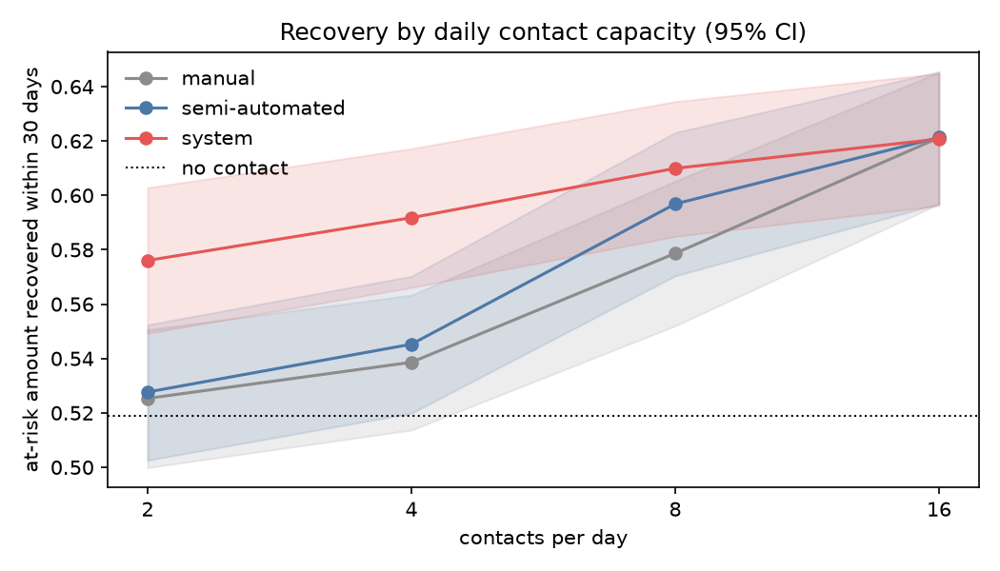

# Controlled experiment: results

The system against its two baselines — a manual collection desk, and an automated campaign
that follows the rules without predicting — on a simulated book of receivables. How the
experiment is built, and every parameter's source, is in `docs/experiment-protocol.md`;
read §1 there first. **This is a simulation.** It shows which mechanism produces a
difference and under what conditions; it does not show what a real operation would recover.

## Findings

**1. Prediction pays only when contact is scarce.** At 2–4 contacts a day the system
recovers 4.7–4.8 pp more of the at-risk amount within 30 days than the semi-automated arm
(d_z ≈ 1.8–2.3; every interval well clear of zero), at a lower cost. At 8 a day the gain
shrinks to 1.3 pp, and from 16 a day on it is gone: there is enough capacity for every
at-risk receivable to get its four attempts inside the window, and once everyone is
contacted, the order in which they were contacted stops mattering. The chart shows it as
three lines that start apart and meet. (Its bands overlap because each carries how much one
simulated book differs from the next; the paired differences below remove that, since every
arm ran on the same book with the same draws.) That is the result the thesis should state: the
predictive module is worth what the operation's scarcity makes it worth, and nothing at all
to an operation that can afford to reach everyone.

**2. The ranking does the work; the reminders do not.** The ablation removes the preventive
reminders and keeps the ranking. Ranking alone delivers the whole gain (+4.8 pp at 2 a
day); the reminders add 0.0–0.1 pp. A reminder to a receivable predicted to default reaches
the customers least likely to answer, and at 13% conversion on a first attempt, the 7–61
reminders sent over the whole horizon are a rounding error. The schedule's "cobrança preventiva" is built and
lawful; it is not where the value is under this response model.

**3. Automation's advantage is cost, not recovery.** Semi-automated and manual recover
almost the same at equal capacity (+0.2 to +1.8 pp) because they work the same list in the
same order. What differs is that a manual call costs R$ 3.90 and a chat message R$ 0.12:
each R$ 1,000 recovered beyond doing nothing costs R$ 34.62 at a 4-a-day desk and R$ 6.37
automated, and R$ 1.94 with the ranking. The manual desk also works weekdays only.

**4. Contacts change *when* people pay much more than *whether*.** Recovery by the horizon
moves by at most 4.5 pp over doing nothing and is the same for every contacting arm at 8 a
day and above: the customers who never pay have the lowest propensity and convert least,
and every arm eventually gives them their four attempts with the same draws. The 30-day
window is where arms differ, which is why it is the primary metric.

**5. The gain is amount-weighted.** Days outstanding — a per-receivable mean — barely
moves between system and semi-automated (−0.1 days) while the amount recovered within 30
days moves by 4.8 pp. The expected-value ranking goes after large balances, so it recovers
money sooner without recovering *receivables* sooner. An operation that cares about the
count of customers back in good standing would rank differently.

**6. Under the sensitivity scenarios the direction holds and the size moves.** If everyone
converts at the average rate (*homogeneous*), the ranking's gain at scarce capacity grows to
6.3–6.5 pp: under the main model the riskiest customers also answer least, and a ranking
that targets risk without modelling response partly works against itself. That points at
the next model to build — one that predicts response to a contact (uplift), not only risk.
If chat converts at half the phone rate (*chat_half*), the gain falls to 2.7–2.9 pp and
stays clear of zero.

**7. The compliance invariant held.** Zero violations across every run, found by an audit
that re-derives the rules from the contact log without importing the policy.

## What these numbers cannot say

- The magnitudes belong to the generator and the response model. The claims are the
  direction, the dependence on capacity, and the ablation.
- The responsive agent is folded into a single conversion draw for every arm alike; the
  quality of the conversation is measured in `docs/responsive-agent.md` and
  `docs/llm-responder.md`, not here.
- The rankers score the cohort once, on the decision day.
- The manual baseline obeys every rule perfectly, which flatters it.

## Tables

<!-- generated:start -->

Generated by `make experiment` on 2026-11-06: 30 replications (seeds 1–30), 1500 simulated runs. Intervals are 95% percentile bootstrap intervals over replications (10,000 resamples); differences are paired by seed.

### The simulated book

| quantity | mean [95% CI] over replications |
|:--|:--|
| receivables in the cohort | 374.7 [369.2, 380.0] |
| at risk (unpaid on the due date, untreated) | 224.1 [218.9, 229.4] |
| at-risk amount (R$) | 1429551 [1366179, 1495790] |
| opted out before the horizon | 11.0 [9.5, 12.6] |
| ranker AUC, not paid within 30 days | 0.758 [0.748, 0.767] |
| ranker AUC, more than 60 days late | 0.788 [0.777, 0.798] |

### Arms by daily capacity (main scenario)

| capacity/day | arm | recovered ≤ 30 days | recovered by horizon | days outstanding | contacts | cost (R$) | R$/contact | R$ per R$ 1,000 gained | violations |
|--:|:--|--:|--:|--:|--:|--:|--:|--:|--:|
| — | no contact | 0.519 [0.493, 0.544] | 0.770 [0.745, 0.794] | 37.5 [36.8, 38.3] | 0 | 0 | 0.00 | — | 0 |
| 2 | manual | 0.525 [0.500, 0.551] | 0.793 [0.769, 0.815] | 36.5 [35.7, 37.3] | 128 | 499 | 3.90 | 52.67 | 0 |
| 2 | semi-automated | 0.528 [0.503, 0.552] | 0.795 [0.771, 0.818] | 36.3 [35.5, 37.1] | 154 | 142 | 0.92 | 11.01 | 0 |
| 2 | ranking only | 0.576 [0.549, 0.602] | 0.807 [0.784, 0.829] | 36.2 [35.5, 37.0] | 154 | 112 | 0.73 | 1.38 | 0 |
| 2 | system | 0.576 [0.549, 0.603] | 0.807 [0.784, 0.829] | 36.2 [35.4, 37.0] | 156 | 112 | 0.72 | 1.36 | 0 |
| 4 | manual | 0.539 [0.514, 0.563] | 0.809 [0.785, 0.831] | 35.4 [34.6, 36.3] | 253 | 987 | 3.90 | 34.62 | 0 |
| 4 | semi-automated | 0.545 [0.520, 0.570] | 0.811 [0.788, 0.833] | 35.1 [34.3, 35.9] | 292 | 239 | 0.82 | 6.37 | 0 |
| 4 | ranking only | 0.591 [0.565, 0.617] | 0.814 [0.792, 0.835] | 35.0 [34.2, 35.8] | 291 | 203 | 0.70 | 1.95 | 0 |
| 4 | system | 0.592 [0.566, 0.617] | 0.814 [0.792, 0.835] | 34.9 [34.2, 35.7] | 294 | 203 | 0.69 | 1.94 | 0 |
| 8 | manual | 0.579 [0.552, 0.605] | 0.814 [0.791, 0.835] | 33.8 [33.0, 34.6] | 383 | 1495 | 3.90 | 17.84 | 0 |
| 8 | semi-automated | 0.597 [0.570, 0.623] | 0.814 [0.791, 0.835] | 33.3 [32.5, 34.1] | 416 | 113 | 0.27 | 1.02 | 0 |
| 8 | ranking only | 0.610 [0.585, 0.634] | 0.815 [0.792, 0.836] | 33.2 [32.4, 34.0] | 406 | 160 | 0.40 | 1.22 | 0 |
| 8 | system | 0.610 [0.585, 0.634] | 0.815 [0.792, 0.836] | 33.1 [32.4, 33.9] | 409 | 155 | 0.38 | 1.19 | 0 |
| 16 | manual | 0.621 [0.597, 0.645] | 0.814 [0.791, 0.835] | 31.9 [31.1, 32.6] | 507 | 1978 | 3.90 | 13.47 | 0 |
| 16 | semi-automated | 0.621 [0.597, 0.645] | 0.814 [0.791, 0.835] | 31.3 [30.6, 32.1] | 541 | 65 | 0.12 | 0.44 | 0 |
| 16 | ranking only | 0.621 [0.596, 0.645] | 0.815 [0.792, 0.836] | 31.4 [30.6, 32.1] | 526 | 78 | 0.15 | 0.53 | 0 |
| 16 | system | 0.621 [0.596, 0.645] | 0.815 [0.792, 0.836] | 31.2 [30.5, 32.0] | 531 | 77 | 0.14 | 0.53 | 0 |
| unlimited | semi-automated | 0.621 [0.597, 0.645] | 0.814 [0.791, 0.835] | 30.3 [29.6, 31.1] | 592 | 71 | 0.12 | 0.48 | 0 |
| unlimited | ranking only | 0.622 [0.598, 0.646] | 0.815 [0.792, 0.836] | 30.3 [29.6, 31.1] | 592 | 71 | 0.12 | 0.48 | 0 |
| unlimited | system | 0.622 [0.598, 0.646] | 0.815 [0.792, 0.836] | 30.2 [29.5, 30.9] | 598 | 72 | 0.12 | 0.48 | 0 |

### Paired differences (main scenario)

| capacity/day | comparison | Δ recovered ≤ 30 days (pp) | d_z | Δ days outstanding | Δ cost (R$) |
|--:|:--|--:|--:|--:|--:|
| 2 | system − semi-automated | +4.8 [+3.9, +5.8] | +1.80 | -0.1 [-0.3, +0.1] | -29 [-32, -27] |
| 2 | system − manual | +5.1 [+4.1, +6.1] | +1.78 | -0.3 [-0.5, -0.1] | -387 [-389, -385] |
| 2 | semi-automated − manual | +0.2 [+0.1, +0.4] | +0.58 | -0.2 [-0.2, -0.2] | -357 [-358, -357] |
| 4 | system − semi-automated | +4.7 [+4.0, +5.4] | +2.25 | -0.1 [-0.3, +0.0] | -36 [-43, -29] |
| 4 | system − manual | +5.3 [+4.6, +6.1] | +2.48 | -0.5 [-0.7, -0.3] | -784 [-791, -777] |
| 4 | semi-automated − manual | +0.7 [+0.4, +0.9] | +0.86 | -0.4 [-0.4, -0.3] | -748 [-753, -742] |
| 8 | system − semi-automated | +1.3 [+0.6, +2.0] | +0.65 | -0.1 [-0.3, +0.0] | +42 [+28, +56] |
| 8 | system − manual | +3.1 [+2.3, +4.0] | +1.22 | -0.6 [-0.8, -0.5] | -1339 [-1367, -1311] |
| 8 | semi-automated − manual | +1.8 [+1.4, +2.3] | +1.34 | -0.5 [-0.5, -0.5] | -1381 [-1401, -1360] |
| 16 | system − semi-automated | -0.1 [-0.2, +0.2] | -0.10 | -0.1 [-0.2, +0.0] | +12 [+9, +15] |
| 16 | system − manual | -0.0 [-0.2, +0.2] | -0.08 | -0.7 [-0.7, -0.6] | -1901 [-1940, -1862] |
| 16 | semi-automated − manual | +0.0 [-0.0, +0.0] | +0.12 | -0.6 [-0.6, -0.5] | -1913 [-1953, -1872] |
| unlimited | system − semi-automated | +0.1 [-0.0, +0.3] | +0.22 | -0.1 [-0.2, -0.1] | +1 [+1, +1] |

### Ablation: the ranking against the reminders (main scenario)

| capacity/day | ranking only − semi-automated (pp) | system − ranking only (pp) | reminders sent |
|--:|--:|--:|--:|
| 2 | +4.8 [+3.9, +5.8] | +0.1 [-0.0, +0.2] | 7 |
| 4 | +4.6 [+3.9, +5.4] | +0.1 [+0.0, +0.1] | 14 |
| 8 | +1.3 [+0.6, +2.1] | -0.0 [-0.1, +0.1] | 29 |
| 16 | -0.1 [-0.2, +0.2] | -0.0 [-0.0, +0.0] | 49 |
| unlimited | +0.1 [-0.0, +0.3] | +0.0 [+0.0, +0.0] | 61 |

### Sensitivity: system − semi-automated, Δ recovered ≤ 30 days (pp)

| capacity/day | main | homogeneous | chat_half |
|--:|--:|--:|--:|
| 2 | +4.8 [+3.9, +5.8] | +6.5 [+5.4, +7.6] | +2.9 [+2.1, +3.7] |
| 4 | +4.7 [+4.0, +5.4] | +6.3 [+5.2, +7.4] | +2.7 [+2.1, +3.3] |
| 8 | +1.3 [+0.6, +2.0] | +1.4 [+0.6, +2.2] | +1.2 [+0.6, +1.9] |
| 16 | -0.1 [-0.2, +0.2] | -0.1 [-0.2, +0.2] | -0.1 [-0.2, -0.0] |
| unlimited | +0.1 [-0.0, +0.3] | +0.1 [-0.1, +0.3] | +0.0 [-0.0, +0.0] |

### Compliance

0 violations found by the independent audit across all 1500 runs.

<!-- generated:end -->

## Concurrency

The schedule's operational target is ≥ 100 concurrent interactions. `make concurrency`
starts the chat in a child process and has N customers open a session and send five messages
each, all starting together. Every level from 1 to 400 conversations completes with **zero
errors**.

Throughput is flat at about 380 requests a second from 50 conversations up: one uvicorn
process is saturated, and past that point latency grows linearly with load — 0.32 s at the
95th percentile for 100 conversations, 1.34 s for 400. The 5-second target of the responsive
agent is met at every level measured; at this rate it would be reached at roughly 1,500
customers sending at the same instant.

Two qualifications. The load is a burst — no customer pauses to read — so it is harsher than
real chat traffic. And the turn uses the template responder; with an LLM generating each
answer, the turn's latency is the provider's latency, and the server's own share measured
here becomes the small part of it. Scaling past one process is not measured, and is not
free: it needs the database-backed session store, and the session-to-tenant routing that
`ChatService` still keeps in process memory.

<!-- concurrency:start -->

Generated by `make concurrency` on 2026-11-06. Each conversation opens a session and sends 5 messages in sequence; all conversations at a level start together behind a barrier. Server: one uvicorn process, in-memory store, TF-IDF retrieval, template responder (no LLM call in the turn).

| concurrent conversations | requests | errors | message p50 (ms) | p95 | p99 | max | session open p95 (ms) | wall (s) | requests/s | messages over 5 s |
|--:|--:|:--|--:|--:|--:|--:|--:|--:|--:|--:|
| 1 | 6 | 0 | 3 | 4 | 4 | 4 | 1 | 0.0 | 357 | 0 |
| 50 | 300 | 0 | 148 | 155 | 157 | 158 | 30 | 0.8 | 394 | 0 |
| 100 | 600 | 0 | 309 | 319 | 322 | 324 | 39 | 1.5 | 388 | 0 |
| 200 | 1200 | 0 | 619 | 643 | 652 | 655 | 160 | 3.2 | 371 | 0 |
| 400 | 2400 | 0 | 1235 | 1342 | 1348 | 1354 | 172 | 6.3 | 380 | 0 |

<!-- concurrency:end -->
