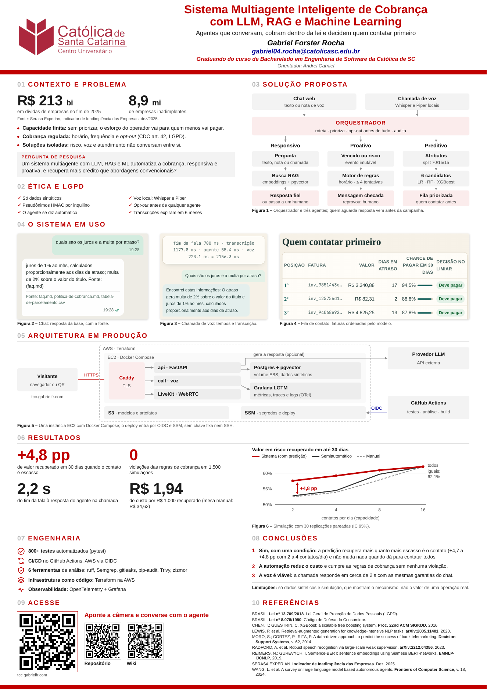

# Pôster A0 — Demo Day

The A0 portrait poster (841 × 1189 mm) for the Poster + Demo Day, in pt-BR. It is a single
HTML page printed to PDF by headless Chromium.

The layout is editorial: a strict two-column grid with 30 mm margins and gutter, ten
numbered sections (grey `01`–`10`, red uppercase letter-spaced title on a thin grey rule),
light fills instead of outlined boxes, and red as the one strong accent. Reading order:
contexto and a compact ética e LGPD list (left column) → solução (with one flow per agent) → the system in use (screenshots) →
arquitetura → resultados (four key numbers and the recovery chart) → engenharia →
conclusões → QR codes → referências.



| File | What it is |
|---|---|
| `index.html` | The poster. Diagrams are inline SVG (vector), one SVG unit = 1 mm. |
| `poster.css` | Layout and the template's colours and type sizes. |
| `poster.js` | Fills the QR captions, drops an empty QR slot, and measures the page in `?check` mode. |
| `qr-targets.conf` | **The only place the QR targets live.** |
| `qr/` | Generated: one SVG per QR code plus `targets.js`. Committed so `index.html` opens without a build. |
| `assets/` | The Católica SC logo (see "Template" below) and the three screenshots (`tela-chat.png`, `tela-chamada.png`, `tela-fila.png`, see "Screenshots"). |
| `export-pdf.sh` | The build. `make poster` runs it. |
| `poster.pdf`, `poster-preview.png` | The output, committed (see "Why the PDF is committed"). |

## Build

```sh
make poster          # = poster/export-pdf.sh
```

Needs `chromium` (or `google-chrome`), `qrencode` and poppler (`pdfinfo`, `pdftoppm`). Nothing
is downloaded: no web fonts, no CDN. The script, in order:

1. regenerates the QR SVGs and `qr/targets.js` from `qr-targets.conf`;
2. opens `index.html?check` headless, and **fails** if any visible text is under 20 pt or if
   anything comes within 4 mm of the footer bar;
3. prints `poster.pdf` (one page, A0) and checks it has exactly one page;
4. renders `poster-preview.png` at 40 dpi.

To preview while editing, open `index.html` in a browser (the page is laid out at real size;
zoom out). Print preview in Chrome shows the exact A0 page.

### How the 20 pt minimum is verified

Two independent measurements, both run on the current build:

- **In the browser** (`poster.js`, `?check`): every visible text node's computed `font-size`,
  multiplied by the SVG's screen transform for diagram labels, converted px → pt (× 0.75).
  The smallest is printed by the build (currently 20.00 pt, the references and source line).
  Text *inside* the screenshots is part of an image and is not measured by the build. It
  was sized by hand instead: each screenshot is cropped to what matters and captured so its
  smallest text, at the width it prints on the poster, is about 20 pt or more (chat 22 pt,
  call 21 pt, queue 21 pt; see "Screenshots").
- **In the PDF**: `pdftotext -bbox poster.pdf -` gives each word's box; Liberation Sans' box
  is 1.117 em tall, so the smallest box (22.34 pt) is a 20.0 pt font. The PDF page is
  2383.92 × 3370.08 pt = 841 × 1189 mm, so these are real printed sizes.

Body text is 24–26 pt, captions 21 pt, diagram labels 21.5–25.5 pt, section headings
32 pt, key numbers 76–80 pt, the title 56 pt.

## Changing the QR targets

Edit `qr-targets.conf` and run `make poster`. Captions follow automatically.

- `PROD_URL` — the production landing page (mandatory element).
- `REPO_URL`, `DOCS_URL` — repository and Wiki (smaller codes beside the production one).
- `VIDEO_URL` — the demo video. **Empty today**, and an empty value removes the slot from the
  poster entirely (no blank box). Paste the URL when the video exists; a third small code
  appears after *Repositório* and *Wiki* (tested with a dummy URL; the layout has room).

The production code is the large one (96 mm), under the call to action *"Aponte a câmera e
converse com o agente"*.

Codes use error correction level Q (25 %), so a scuffed print still scans. The build was
checked by rendering the PDF at 100 dpi and decoding it with `zbarimg`: all codes decode to
their configured URLs (and the video slot was tested with a dummy URL, then emptied again).

## Template (official, mandatory)

From `demoday/TEMPLATE_POSTER_PORTFOLIO.pptx` in The Portfolio Playbook — the institution's
own template for this poster, so using its logo and look here is its intended use.

| Element | Template | Here |
|---|---|---|
| Logo | `ppt/media/image1.jpeg`, top left | Same image; `assets/logo-catolica-sc-template.jpg` is the untouched original |
| Title | Arial bold, `#C00000`, centred right of the logo | Same, 56 pt, followed by a one-line subtitle |
| Author | bold italic, black | Same |
| E-mail | bold italic, `#000099` | Same (institutional e-mail from `rfc.pdf`) |
| Course line | bold italic, `#C00000`, text "Graduando do curso de Bacharelado em Engenharia de Software da Católica de SC" | Same text |
| Header rule | red bar `#C00000` across the page under the header | Same, 7.4 mm |
| Footer | red bar `#C00000` across the page, ~1 mm from the bottom edge | Same |
| Section headings | Arial bold uppercase `#C00000`, centred | Arial bold uppercase `#C00000`, left-aligned and letter-spaced, numbered (editorial style) |
| Body | Arial, black on white | Liberation Sans (metric-compatible with Arial), black on white |

The template's page is 800 × 950 mm; header sizes were scaled by 841/800 to A0 width.
The original logo is 384 × 142 px (≈ 45 dpi at poster size), so `assets/logo-catolica-sc.png`
is an 8× upscale of it, cleaned for print and with a transparent background — same artwork,
single colour `#AD283E` sampled from the original:

```sh
magick image1.jpeg -colorspace gray -filter Lanczos -resize 800% -blur 0x6 -level 38%,62% mask.png
magick -size 3072x1136 xc:"#AD283E" \( mask.png -negate \) -alpha off \
  -compose CopyOpacity -composite -depth 8 logo-catolica-sc.png
```

The template was checked for anything better: its `ppt/media/` holds only that same
384 × 142 JPEG (plus the example poster's screenshots), and the template PDF embeds the same
raster, so there is no vector logo to extract. An official vector logo from the
institution's communication office would be better still.

## Screenshots

`assets/tela-*.png` are the running app, captured on 2026-11-14 with headless Chromium
(puppeteer-core driving the system `chromium`) at device scale factor 5. Synthetic data
only. Each one is cropped to the part that matters, and the page was laid out narrow (or
its smallest labels enlarged with an injected stylesheet) so that the smallest text in the
crop prints at about 20 pt or more at its width on the poster — recaptured larger, never
upscaled.

| File | Page | What was changed for print | How it was captured |
|---|---|---|---|
| `tela-chat.png` | `/app/chat`, widget open: the question and its answer | timestamps and source line 11 → 12.5 px | `collection serve` on the seeded *Desenvolvimento* tenant with `LLM_PROVIDER=openai LLM_MODEL=qwen2.5:3b` on the local Ollama (production uses an external provider; the template responder quotes the whole FAQ, unreadable in a bubble — see `default_responder` in `api/chat.py`) |
| `tela-chamada.png` | `/app/call`: the per-stage timing line, the question and the answer | orb, status and buttons hidden; timing line 12 → 16 px; earlier turns (disclaimer, greeting) hidden | `collection call serve` with the LiveKit container, 420 px wide. Chromium's fake microphone played *"Quais são os juros e a multa por atraso?"* synthesised with the local Piper voice `pt_BR-cadu-medium` at `length_scale=1.1`; the `faber` voice was transcribed as *"ataso"* in every take, `cadu` cleanly |
| `tela-fila.png` | `/app/fila`: the heading and the top three rows | lead text, model facts and the *Cliente* column hidden; root font 20 px; headers, ids and tags 0.9 rem | `collection serve` with a freshly trained local model and the duplicate-column fix from PR #58 |

To recapture, run both servers as in the main README, open the pages with the `aviso_lido`
cookie set, and crop to the widget, the call card plus transcript, and the table.

The diagrams went lighter too: the old 4 × 5 pipeline grid is now one three-step flow under
each agent inside the *Solução proposta* figure, and the architecture keeps every
production component (EC2 with Caddy, api, call, LiveKit, Postgres + pgvector, Grafana LGTM;
S3, SSM, the external LLM provider, GitHub Actions over OIDC, the visitor) with fewer
crossings and labels on their arrows.

## Where every number comes from

Each number also has an HTML comment next to it in `index.html` naming its source.

| On the poster | Value | Source |
|---|---|---|
| Dívidas de empresas, fim de 2025 | R$ 213 bi | Serasa Experian, *Indicador de Inadimplência das Empresas*, dez/2025 (as in `pitch/index.html`) — **external, not in `docs/`** |
| Empresas inadimplentes | 8,9 mi | same |
| Divisão dos dados, candidatos | 70/15/15 cronológica, 6 candidatos (LR · RF · XGBoost) | README *Predictive module*; `docs/model-synthetic-*.md`; article §3.1 |
| Tentativas | ≤ 4 | `docs/collection-rules.md` (`max_attempts = 4`) |
| Recuperado a mais com contato escasso | +4,8 pp | `docs/experiment-results.md`, *Paired differences*, 2/day, system − semi-automated, +4.8 [+3.9, +5.8] |
| Violações | 0 em 1.500 simulações | `docs/experiment-results.md`, *Compliance* (0 violations across all 1500 runs) |
| Turno da chamada | 2,2 s | `docs/voice-call.md` / `docs/voice-call-report-live.md`: 2,174 ms median over WebRTC |
| Custo por R$ 1.000 recuperado | R$ 1,94 sistema × R$ 34,62 manual (4 contatos/dia) | `docs/experiment-results.md`, column *R$ per R$ 1,000 gained*; Finding 3 |
| Curvas do gráfico | sistema 57,6 / 59,2 / 61,0 / 62,1 %; semiautomático 52,8 / 54,5 / 59,7 / 62,1 %; manual 52,5 / 53,9 / 57,9 / 62,1 % (2/4/8/16 por dia) | `docs/experiment-results.md`, *Arms by daily capacity* |
| Simulação | 30 replicações, IC 95 % | `docs/experiment-results.md`, generated header |
| Conclusão 1 | +4,7 a +4,8 pp com 2 a 4 contatos/dia | `docs/experiment-results.md`, Finding 1 (4/day +4.7, 2/day +4.8); article §5 |
| Conclusão 3 | cerca de 2 s | article §5.3 (*responde em cerca de 2 s*) |
| Ética e LGPD | 6 meses de retenção | `docs/architecture.md`, `transcript_retention_days` (180) |
| Testes | 800+ | `uv run pytest --collect-only -q` on 2026-11-14: 849 tests |
| Ferramentas de análise | 6 | `docs/static-analysis.md`: ruff, Semgrep CE, gitleaks, pip-audit, Trivy, zizmor |

The predictive models' metrics (`docs/model-synthetic-*.md`) are deliberately **not** on the
poster as results: those documents say the synthetic numbers verify the training protocol
and "must not be cited as findings".

The architecture diagram follows the production decisions (one EC2 with Docker Compose,
Caddy, LiveKit, Postgres + pgvector on EBS, S3, Grafana LGTM, GitHub Actions with OIDC and
deploy over SSM; the images on GHCR are left out to keep it readable). Update it if the deployed shape changes.

## Why the PDF is committed

`poster.pdf` (about 1.4 MB, most of it the screenshots) and `poster-preview.png` are tracked, like `cronograma.pdf` and unlike
`article/main.pdf`:

- the poster PDF *is* the deliverable ("Poster digital (PDF) com QR Code"), and teachers and
  the Wiki should be able to open it from GitHub without a Chromium build;
- it is small and changes rarely, so history cost is negligible;
- the article PDF stays untracked because it needs a 15-minute TeX image and is rebuilt from
  source on demand; the poster builds in seconds, so drift is cheap to fix — rebuild with
  `make poster` and commit source and PDF together.

The final PDF is also attached to the release.
