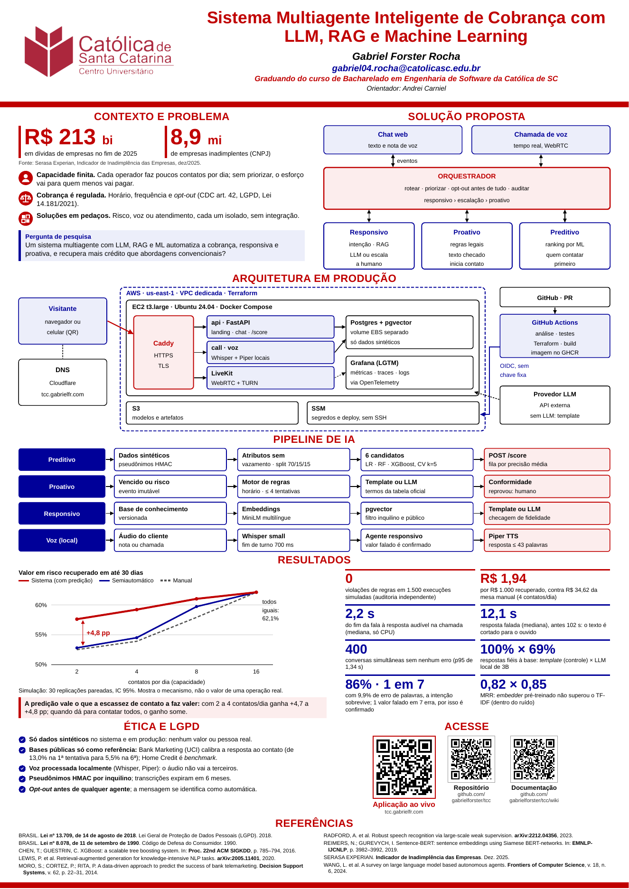

# Pôster A0 — Demo Day

The A0 portrait poster (841 × 1189 mm) for the Poster + Demo Day, in pt-BR. It is a single
HTML page printed to PDF by headless Chromium.



| File | What it is |
|---|---|
| `index.html` | The poster. Diagrams are inline SVG (vector), one SVG unit = 1 mm. |
| `poster.css` | Layout and the template's colours and type sizes. |
| `poster.js` | Fills the QR captions, drops an empty QR slot, and measures the page in `?check` mode. |
| `qr-targets.conf` | **The only place the QR targets live.** |
| `qr/` | Generated: one SVG per QR code plus `targets.js`. Committed so `index.html` opens without a build. |
| `assets/` | The Católica SC logo (see "Template" below). |
| `export-pdf.sh` | The build. `make poster` runs it. |
| `poster.pdf`, `poster-preview.png` | The output, committed (see "Why the PDF is committed"). |

## Build

```sh
make poster          # = poster/export-pdf.sh
```

Needs `chromium` (or `google-chrome`), `qrencode` and poppler (`pdfinfo`, `pdftoppm`). Nothing
is downloaded: no web fonts, no CDN. The script, in order:

1. regenerates the QR SVGs and `qr/targets.js` from `qr-targets.conf`;
2. opens `index.html?check` headless, and **fails** if any visible text is under 20 pt or if
   anything comes within 4 mm of the footer bar;
3. prints `poster.pdf` (one page, A0) and checks it has exactly one page;
4. renders `poster-preview.png` at 40 dpi.

To preview while editing, open `index.html` in a browser (the page is laid out at real size;
zoom out). Print preview in Chrome shows the exact A0 page.

### How the 20 pt minimum is verified

Two independent measurements, both run on the current build:

- **In the browser** (`poster.js`, `?check`): every visible text node's computed `font-size`,
  multiplied by the SVG's screen transform for diagram labels, converted px → pt (× 0.75).
  The smallest is printed by the build (currently 20.00 pt, the references and source line).
- **In the PDF**: `pdftotext -bbox poster.pdf -` gives each word's box; Liberation Sans' box
  is 1.117 em tall, so the smallest box (22.34 pt) is a 20.0 pt font. The PDF page is
  2383.92 × 3370.08 pt = 841 × 1189 mm, so these are real printed sizes.

Body text is 26 pt, diagram labels 22–25 pt, headings 40 pt, the title 64 pt.

## Changing the QR targets

Edit `qr-targets.conf` and run `make poster`. Captions follow automatically.

- `PROD_URL` — the production landing page (mandatory element).
- `REPO_URL`, `DOCS_URL` — repository and Wiki.
- `VIDEO_URL` — the demo video. **Empty today**, and an empty value removes the slot from the
  poster entirely (no blank box). Paste the URL when the video exists; the fourth code appears
  next to the others and the layout already has room for it.

Codes use error correction level Q (25 %), so a scuffed print still scans. The build was
checked by rendering the PDF at 100 dpi and decoding it with `zbarimg`: all codes decode to
their configured URLs (and the video slot was tested with a dummy URL, then emptied again).

## Template (official, mandatory)

From `demoday/TEMPLATE_POSTER_PORTFOLIO.pptx` in The Portfolio Playbook — the institution's
own template for this poster, so using its logo and look here is its intended use.

| Element | Template | Here |
|---|---|---|
| Logo | `ppt/media/image1.jpeg`, top left | Same image; `assets/logo-catolica-sc-template.jpg` is the untouched original |
| Title | Arial bold, `#C00000`, centred right of the logo | Same, 64 pt |
| Author | bold italic, black | Same |
| E-mail | bold italic, `#000099` | Same (institutional e-mail from `rfc.pdf`) |
| Course line | bold italic, `#C00000`, text "Graduando do curso de Bacharelado em Engenharia de Software da Católica de SC" | Same text |
| Header rule | red bar `#C00000` across the page under the header | Same, 7.4 mm |
| Footer | red bar `#C00000` across the page, ~1 mm from the bottom edge | Same |
| Section headings | Arial bold uppercase `#C00000`, centred | Same |
| Body | Arial, black on white | Liberation Sans (metric-compatible with Arial), black on white |

The template's page is 800 × 950 mm; header sizes were scaled by 841/800 to A0 width.
The original logo is 384 × 142 px (≈ 45 dpi at poster size), so `assets/logo-catolica-sc.png`
is an 8× upscale of it, cleaned for print and with a transparent background — same artwork,
single colour `#AD283E` sampled from the original:

```sh
magick image1.jpeg -colorspace gray -filter Lanczos -resize 800% -blur 0x6 -level 38%,62% mask.png
magick -size 3072x1136 xc:"#AD283E" \( mask.png -negate \) -alpha off \
  -compose CopyOpacity -composite -depth 8 logo-catolica-sc.png
```

An official vector logo from the institution's communication office would be better still.

## Where every number comes from

Each number also has an HTML comment next to it in `index.html` naming its source.

| On the poster | Value | Source |
|---|---|---|
| Dívidas de empresas, fim de 2025 | R$ 213 bi | Serasa Experian, *Indicador de Inadimplência das Empresas*, dez/2025 (as in `pitch/index.html`) — **external, not in `docs/`** |
| Empresas inadimplentes | 8,9 mi | same |
| Recuperado ≤ 30 dias, curvas do gráfico | sistema 57,6 / 59,2 / 61,0 / 62,1 %; semiautomático 52,8 / 54,5 / 59,7 / 62,1 %; manual 52,5 / 53,9 / 57,9 / 62,1 % (2/4/8/16 por dia) | `docs/experiment-results.md`, *Arms by daily capacity* |
| Ganho com 2 contatos/dia | +4,8 pp | `docs/experiment-results.md`, *Paired differences*, system − semi-automated, +4.8 [+3.9, +5.8] |
| Ganho com 2 a 4 contatos/dia | +4,7 a +4,8 pp | same, Finding 1 |
| Simulação | 30 replicações, IC 95 % | `docs/experiment-results.md`, generated header |
| Violações | 0 em 1.500 execuções | `docs/experiment-results.md`, *Compliance* |
| Custo por R$ 1.000 recuperado (4/dia) | R$ 1,94 sistema × R$ 34,62 manual | `docs/experiment-results.md`, column *R$ per R$ 1,000 gained* |
| Turno da chamada | 2,2 s | `docs/voice-call.md` / `docs/voice-call-report-live.md`: 2,174 ms median over WebRTC |
| Resposta falada | 12,1 s (antes 102 s) | `docs/voice-call.md`, *What the agent says, cut for the ear* |
| Fim de turno | 700 ms | `docs/voice-call.md`, endpointer hangover |
| Orçamento de fala | ≤ 43 palavras | `docs/voice-call.md` (20 s × 2.15 words/s) |
| Concorrência | 400 conversas, 0 erros, p95 1,34 s | `docs/experiment-results.md`, *Concurrency* (1,342 ms) |
| Fidelidade das respostas | 100 % × 69 % | `docs/responder-comparison.md`, faithful_rate 1.0 (template) × 0.6923 (`qwen2.5:3b`, local) |
| Voz: intenção / valores | 86 %, 1 valor em 7, a WER 0,099 (9,9 %) | `docs/voice.md` and `docs/voice-report.md` (intent 0.856, figures intact 0.867) |
| RAG, MRR | 0,82 × 0,85 | `docs/rag.md`, customer-facing corpus: pgvector 0.8194 × TF-IDF 0.8472 |
| Tentativas | ≤ 4; resposta 13,0 % → 5,5 % da 1ª à 6ª | `docs/collection-rules.md` (`max_attempts = 4`), `docs/eda-bank-marketing.md` |
| Divisão dos dados | 70/15/15 cronológica, CV k=5, 6 candidatos | README *Predictive module*; `docs/model-synthetic-*.md`; article §3.1 |
| Retenção de transcrições | 6 meses | `docs/architecture.md`, `transcript_retention_days` |

The predictive models' metrics (`docs/model-synthetic-*.md`) are deliberately **not** on the
poster as results: those documents say the synthetic numbers verify the training protocol
and "must not be cited as findings".

The architecture diagram follows the production decisions (one EC2 with Docker Compose,
Caddy, LiveKit, Postgres + pgvector on EBS, S3, Grafana LGTM, GitHub Actions with OIDC and
deploy over SSM, images on GHCR). Update it if the deployed shape changes.

## Why the PDF is committed

`poster.pdf` (< 1 MB) and `poster-preview.png` are tracked, like `cronograma.pdf` and unlike
`article/main.pdf`:

- the poster PDF *is* the deliverable ("Poster digital (PDF) com QR Code"), and teachers and
  the Wiki should be able to open it from GitHub without a Chromium build;
- it is small and changes rarely, so history cost is negligible;
- the article PDF stays untracked because it needs a 15-minute TeX image and is rebuilt from
  source on demand; the poster builds in seconds, so drift is cheap to fix — rebuild with
  `make poster` and commit source and PDF together.

The final PDF is also attached to the release.
