# O que esta prévia mostra

Duas partes do sistema que ainda **não estão construídas** e que aqui aparecem como
protótipos de tela, montados sobre o que **já existe e foi medido**:

| | Tela | O que é real | O que é protótipo |
|:--|:--|:--|:--|
| 1 | **Chamada de voz** (entrega 15) | o áudio (sintetizado localmente pelo Piper), a transcrição pelo Whisper local, a intenção, a consulta à base, a regra de leitura de volta e todos os tempos medidos | a tela, o transporte WebRTC, a geração do texto do agente |
| 2 | **Console interno** | as probabilidades dos dois modelos publicados e o porquê de cada uma (SHAP) para os 1.167 clientes; a tabela de parcelamento e os limites de alçada | a tela, os nomes, os contadores operacionais do dia |

**Arquivos que acompanham este PDF:**

- `video/00-demo-voz-e-console.mp4`: as duas demonstrações com cartelas, 1 min 58 s, **com áudio**
- `video/02-chamada-de-voz.mp4`: a chamada completa, 69 s, com áudio
- `video/01-console.mp4`: o percurso pelo console, 40 s
- `img/`: todas as telas em alta resolução
- `mock/`: as páginas do protótipo, que abrem no navegador (`console.html`, `voz.html`)

# 1. A chamada de voz

O cliente atende uma chamada no navegador. O aviso de gravação é a primeira frase e não
pode ser pulado. Ao lado, o painel **Por dentro do agente** mostra, a cada turno, o que o
sistema ouviu, o que entendeu, o que consultou e quanto tempo cada etapa levou.

::: row
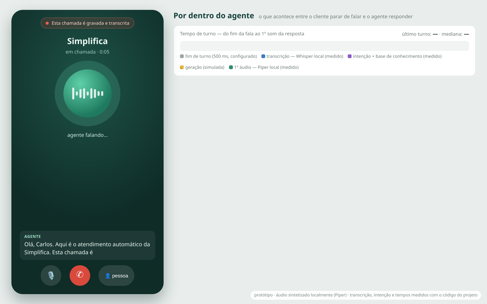{width=48%}

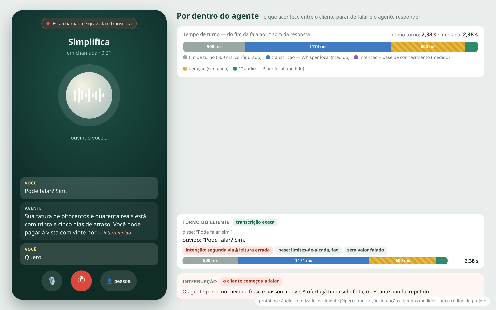{width=48%}
:::

::: row
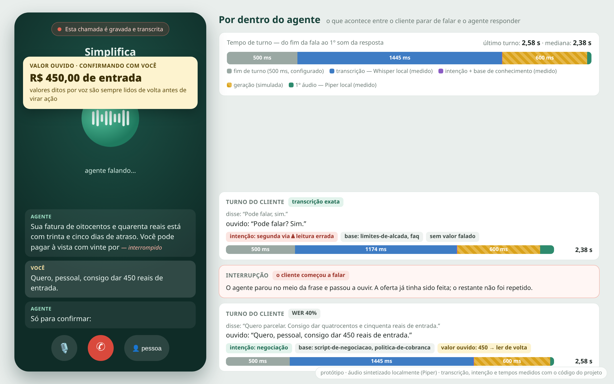{width=48%}

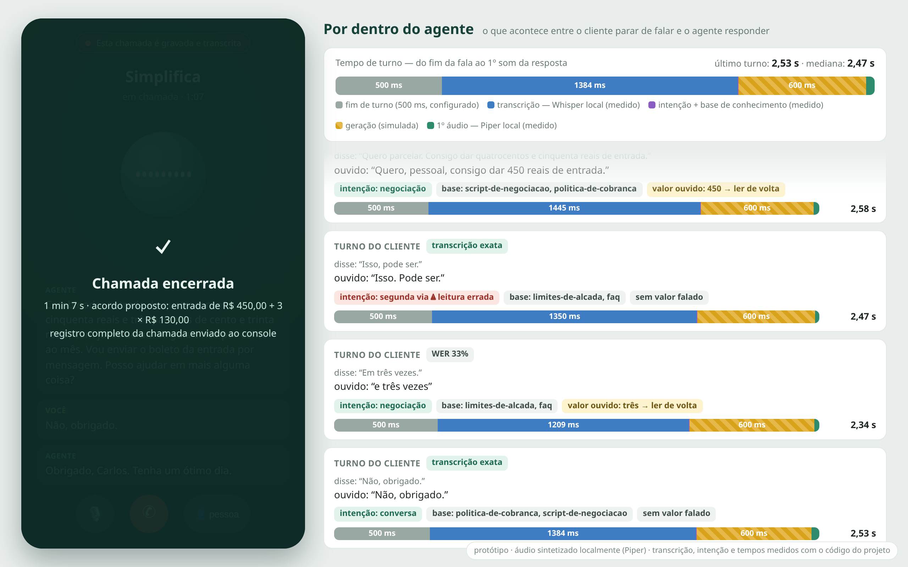{width=48%}
:::

**O roteiro.** Carlos deve R$ 840,00 com 35 dias de atraso, o que o coloca na faixa de 31 a
60 dias da tabela: entrada mínima de 15%, até 10 parcelas, 20% de desconto à vista e juros
de 1,5% ao mês. Ele oferece R$ 450,00 de entrada e o restante em 3 vezes de R$ 130,00:
dentro da alçada automática (até 12 parcelas) e acima da parcela mínima de R$ 50,00.

## O que cada turno custa

Medido nesta máquina (Ryzen 7 5700X3D, só CPU) com o código do projeto: o áudio do cliente
foi sintetizado pelo Piper, transcrito pelo `WhisperTranscriber` (modelo `small`, int8), e
o texto passou pelo classificador de intenção, pela resolução de intenção pelo contexto da
conversa, pela busca na base e pela regra `needs_confirmation`.

| O cliente disse | O Whisper ouviu | Intenção | Lê de volta? | STT | Turno |
|:--|:--|:--|:-:|--:|--:|
| “Pode falar, sim.” | “Pode falar? Sim.” | segunda via ⚠ | — | 1.174 ms | 2,38 s |
| “Quero parcelar. Consigo dar quatrocentos e cinquenta reais de entrada.” | “Quero, pessoal, consigo dar 450 reais de entrada.” | negociação | **450** | 1.445 ms | 2,58 s |
| “Isso, pode ser.” | “Isso. Pode ser.” | segunda via ⚠ | — | 1.350 ms | 2,47 s |
| “Em três vezes.” | “e três vezes” | negociação | **três** | 1.209 ms | 2,34 s |
| “Não, obrigado.” | “Não, obrigado.” | conversa | — | 1.384 ms | 2,53 s |

**Tempo de turno** (do fim da fala ao primeiro som da resposta), mediana **2,47 s**:

| Etapa | Tempo | Origem |
|:--|--:|:--|
| Detecção de fim de turno | 500 ms | configurado (janela de silêncio), não medido |
| Transcrição (Whisper `small`, local) | **1.174–1.445 ms** | medido |
| Intenção + base de conhecimento | 2,5–3,5 ms | medido |
| Geração do texto | 600 ms | **simulado**: sem chave de LLM nesta máquina |
| Primeiro áudio da resposta (Piper, local) | 21–101 ms | medido |

## O que a prévia revelou

1. **A transcrição domina o tempo do turno.** A síntese de voz local é quase gratuita: o
   Piper produz o primeiro áudio em 21–101 ms e fala 38 vezes mais rápido que o tempo
   real. Já o Whisper leva cerca de 1,3 s por frase, na proporção de 0,5 s de
   processamento por segundo de fala. A primeira otimização a tentar é transcrever enquanto
   o cliente ainda fala, não trocar a voz.
2. **O erro de reconhecimento atingiu os valores, como a medição anterior previu.**
   “Quero parcelar” virou “Quero, pessoal” (40% de palavras erradas) e, mesmo assim, a
   intenção (*negociação*) e o valor (450) sobreviveram. Os dois valores falados na chamada
   dispararam a leitura de volta, e é por isso que ela existe.
3. **Uma lacuna real: a resposta a uma pergunta de sim/não.** “Pode falar, sim” e
   “Isso, pode ser” foram classificadas como *segunda via*. Uma palavra casou fracamente com
   uma frase-pista dessa intenção, com confiança de 0,076, acima do mínimo de 0,04. Assim o
   agente se considera seguro e nem consulta o contexto da conversa. No chat isso quase não
   aparece; na voz, onde toda leitura de volta termina num “sim”, aparece em todo turno.
   **Correção para a entrega 15:** depois de uma leitura de volta, a próxima fala é tratada
   como confirmação (sim/não), não reclassificada.
4. **Um defeito encontrado no caminho:** com a versão 19 da biblioteca `av` instalada pelo
   `uv.lock`, a transcrição real pelo Whisper falha (`metadata_errors`). A CI não percebe
   porque usa o transcritor roteirizado. Fixar `av<19` resolve; as medições acima foram
   feitas com `av` 18.

# 2. O console interno: como os modelos enxergam cada cliente

Cada ponto do gráfico é um cliente real da base de demonstração. A posição vem das duas
probabilidades que os modelos publicados calculam para ele: **propensão a pagar** (eixo
horizontal) e **risco de inadimplência** (eixo vertical).

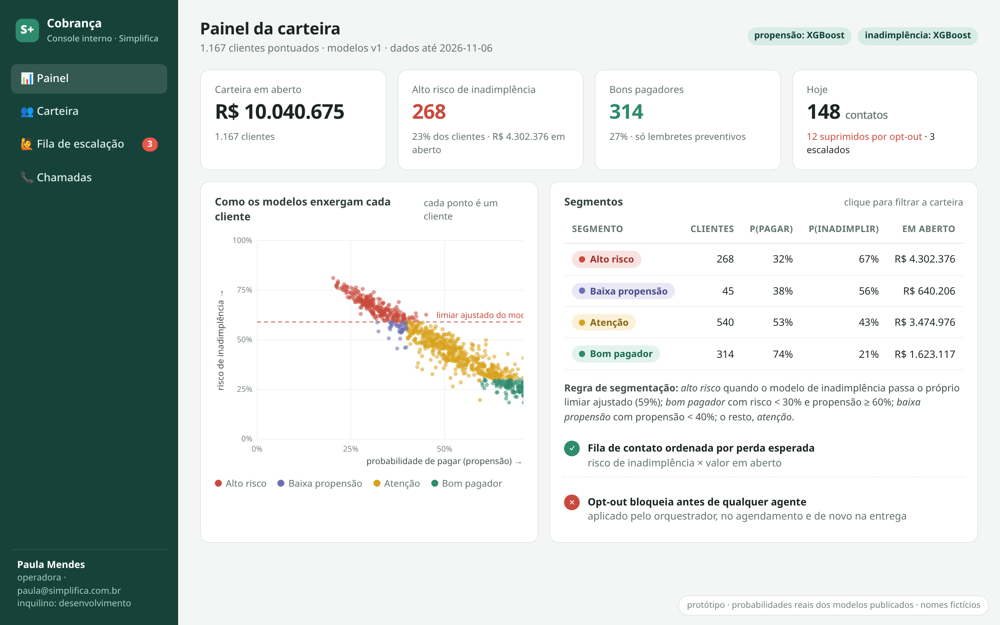{width=100%}

| Segmento | Regra | Clientes | P(pagar) | P(inadimplir) | Atraso médio histórico | Faturas pagas com atraso |
|:--|:--|--:|--:|--:|--:|--:|
| **Alto risco** | inadimplência ≥ limiar ajustado (59%) | 268 | 32% | 67% | 178 dias | 92% |
| **Baixa propensão** | propensão < 40% | 45 | 38% | 56% | 113 dias | 87% |
| **Atenção** | o restante | 540 | 53% | 43% | 41 dias | 55% |
| **Bom pagador** | risco < 30% e propensão ≥ 60% | 314 | 74% | 21% | 7 dias | 34% |

Os segmentos não foram desenhados à mão sobre o histórico: saem das duas probabilidades. O
histórico de cada segmento (as duas últimas colunas) mostra que eles separam
comportamentos de fato diferentes. A probabilidade de inadimplência não está calibrada (o
modelo foi treinado com peso extra na classe rara), por isso o corte usa o **limiar
ajustado do próprio modelo**, não 50%.

## Um cliente de cada lado

::: row
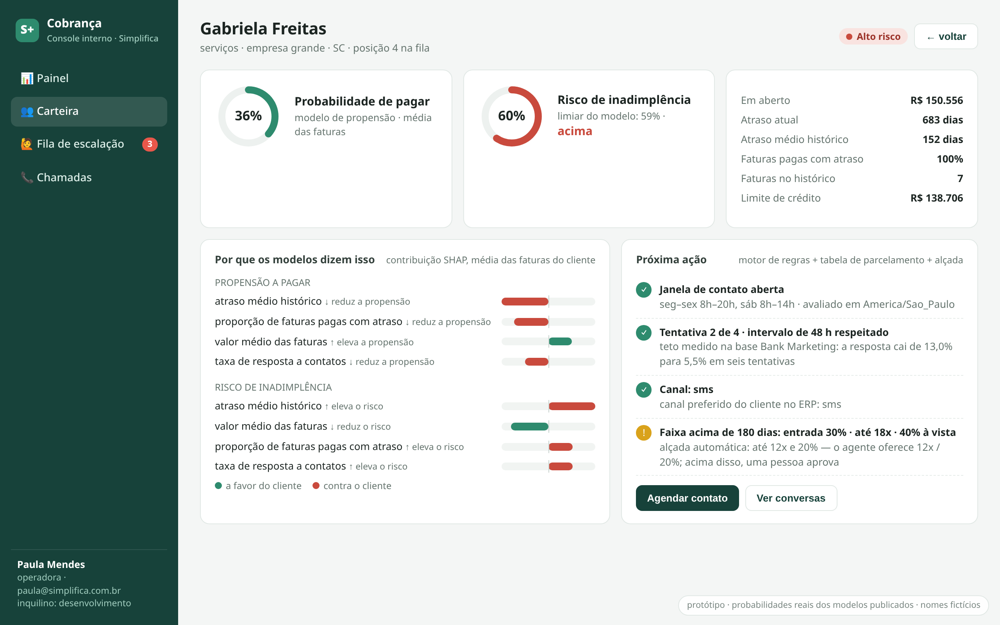{width=48%}

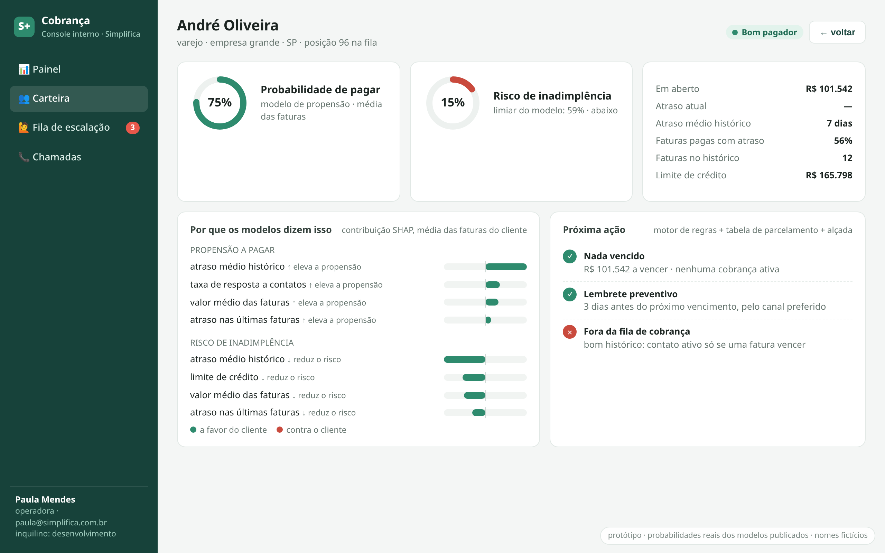{width=48%}
:::

**Por que os modelos dizem isso.** Para cada cliente, a contribuição SHAP de cada variável,
na média das suas faturas. As explicações batem com o histórico: no cliente de alto risco,
o atraso médio histórico e a proporção de faturas pagas com atraso empurram o risco para
cima; no bom pagador, o mesmo atraso médio histórico (7 dias) é o que mais o empurra para
baixo, seguido pelo limite de crédito e pelo atraso das últimas faturas.

**Próxima ação.** O console junta o que os modelos dizem com o que as regras permitem:
janela de horário legal (em `America/Sao_Paulo`), limite de tentativas e intervalo medidos
na base Bank Marketing, canal preferido do cliente, a faixa da tabela de parcelamento e os
limites de alçada.

::: row
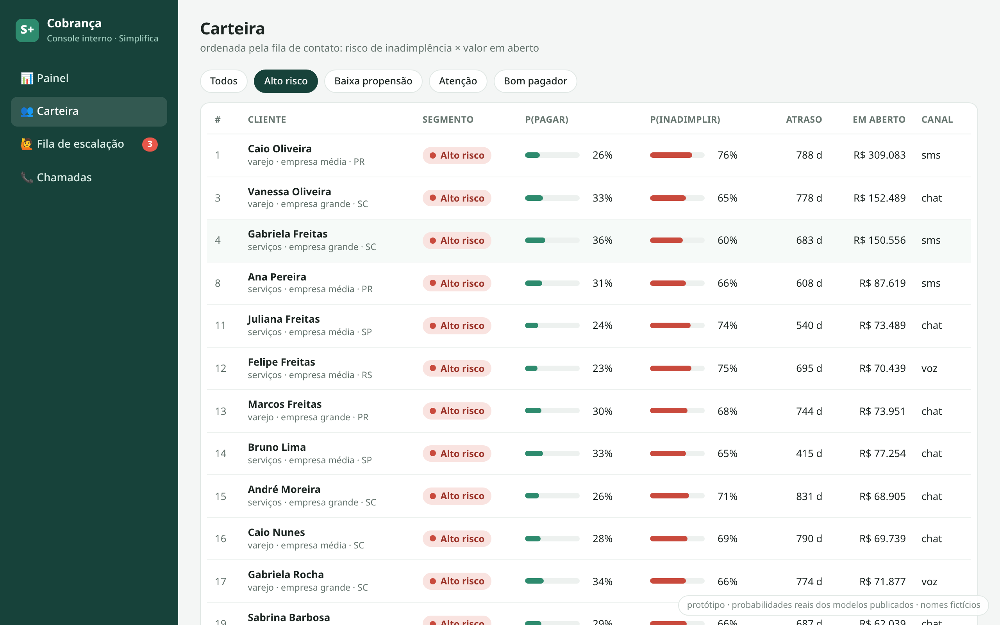{width=48%}

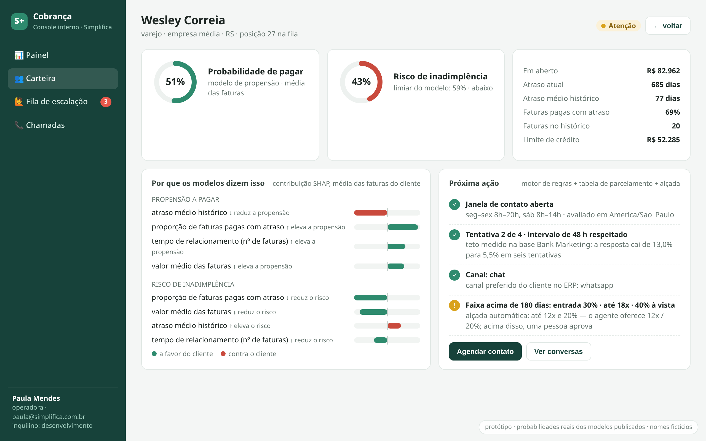{width=48%}
:::

## Quando o agente entrega a conversa para uma pessoa

::: row
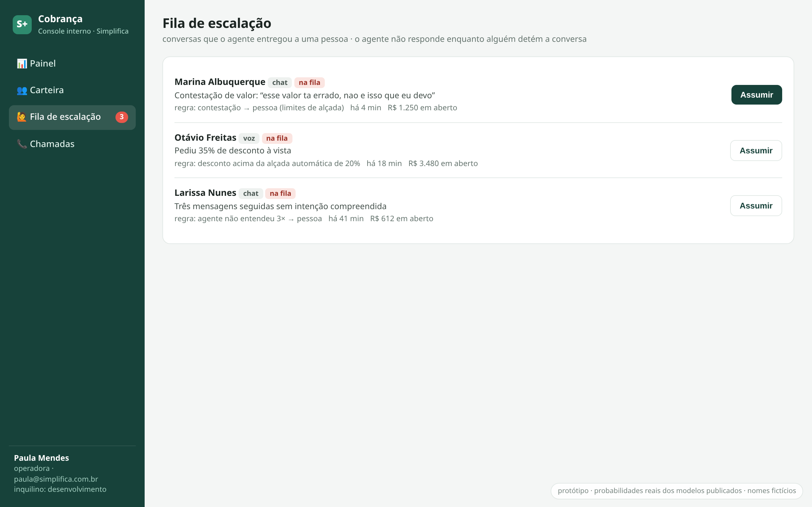{width=48%}

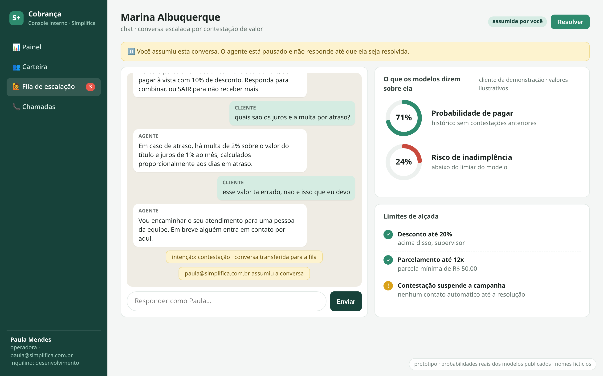{width=48%}
:::

::: row
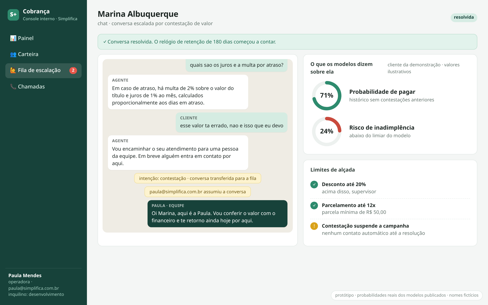{width=48%}

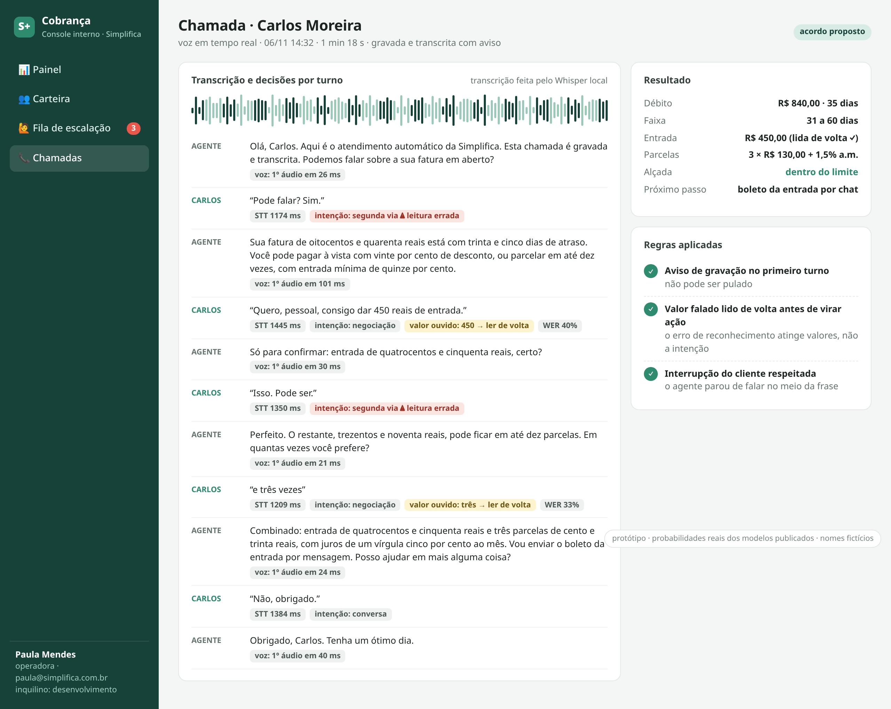{width=48%}
:::

A fila e o “assumir/resolver” já existem no código (PR #29, comandos `make queue`,
`claim`, `resolve`); o que esta tela acrescenta é a interface.

# Notas sobre esta prévia

- **As probabilidades e as explicações são reais**: saem dos modelos publicados (v1),
  aplicados aos 1.167 clientes da base sintética de demonstração, pelo mesmo caminho do
  comando `collection score`. O script está em `scripts/export_portfolio.py`.
- **Os nomes são fictícios** e gerados a partir do identificador pseudonimizado. Marina e
  Carlos são clientes de demonstração; os medidores da Marina são ilustrativos.
- **Contadores do dia** no painel (148 contatos, 12 suprimidos, 3 escalados) são ilustrativos.
- **O texto do agente na chamada é roteirizado** a partir da tabela de parcelamento e dos
  limites de alçada; a etapa de geração aparece no tempo de turno como 600 ms simulados.
- **As duas vozes são do Piper** (`faber` para o agente, `jeff` para o cliente), rodando
  localmente: nenhum áudio saiu da máquina. É também a candidata natural para a decisão de
  TTS da entrega 15.
