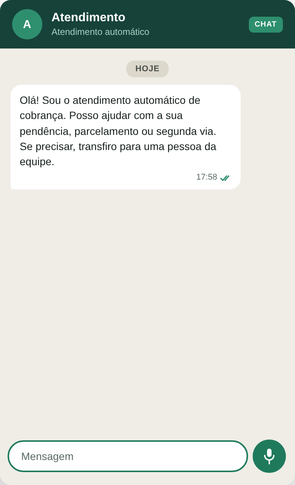
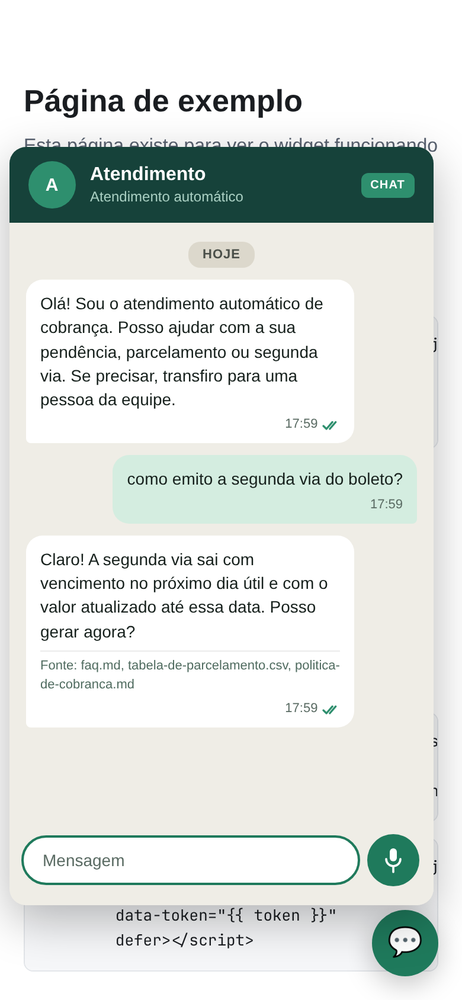
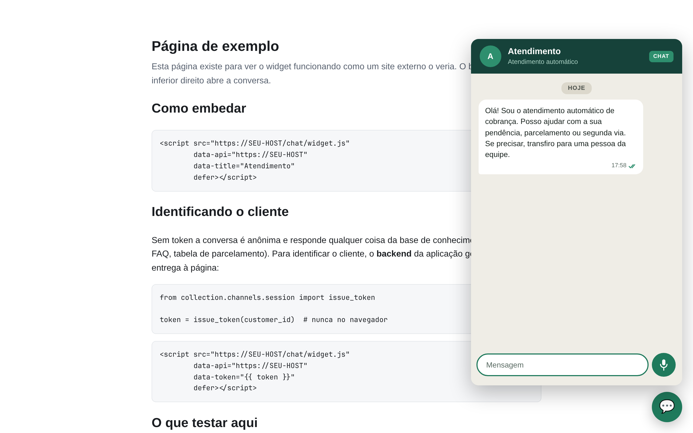
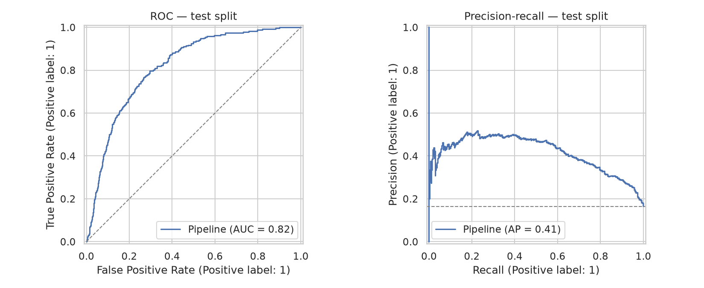
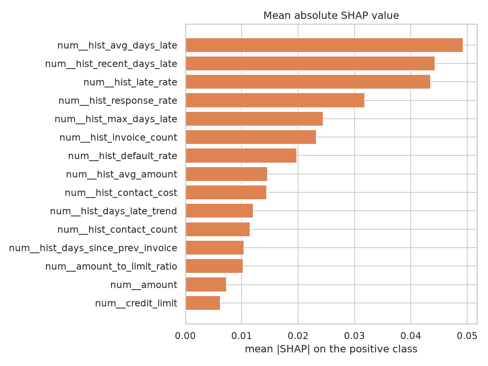
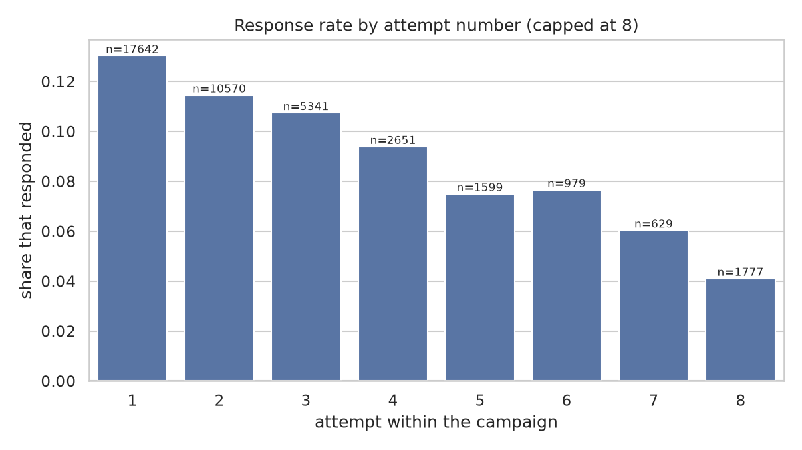
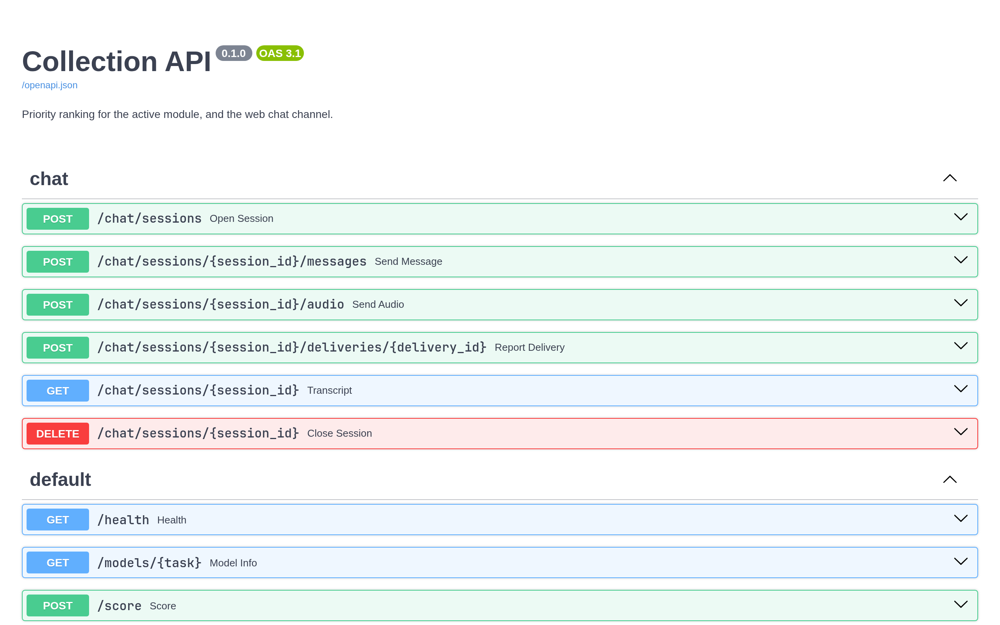

# Em uma página

O sistema conduz a cobrança de recebíveis com três agentes coordenados por um orquestrador
central: um **agente responsivo** que atende o cliente com respostas ancoradas na base de
conhecimento (RAG), um **agente proativo** que decide quem contatar, quando e por qual canal
dentro das restrições legais, e um **agente preditivo** que ordena a fila por probabilidade
de pagamento e de inadimplência futura.

| | |
|:--|:--|
| **Entregas do cronograma concluídas** | 14 de 19 (até 29/10) |
| **Pull requests integrados** | 28 |
| **Testes automatizados** | 689 |
| **Código** | ~14,6 mil linhas de produção · ~8,5 mil de teste |
| **Pendente** | voz em tempo real (entrega 15) e a fase de avaliação e redação (16–19) |

**O que esta prévia mostra:** o widget de chat funcionando de ponta a ponta (contato
proativo, dúvidas respondidas, contestação escalada para uma pessoa, *opt-out*), os modelos
preditivos com suas métricas, e as avaliações já medidas de cada módulo.

**Arquivos que acompanham este PDF:**

- `video/00-demo-completo.mp4`: demonstração de 49 s com as três cenas
- `video/01-conversa.mp4`, `02-opt-out.mp4`, `03-celular.mp4`: as cenas separadas
- `img/`: todas as capturas e gráficos em alta resolução
- `terminal/`: a saída bruta de cada comando de avaliação executado hoje

# Arquitetura

```
              ┌──────────────────────────────────────────┐
              │              ORQUESTRADOR                │
              │  roteia · prioriza · aplica opt-out      │
              │  · registra                              │
              └──────────────────────────────────────────┘
                   │              │               │
        ┌──────────┘              │               └──────────┐
        ▼                         ▼                          ▼
┌────────────────┐      ┌──────────────────┐      ┌────────────────────┐
│   RESPONSIVO   │      │     PROATIVO     │      │     PREDITIVO      │
│ intenção + RAG │      │ motor de regras  │      │ ranking via API    │
│ + LLM          │      │ + composição     │      │ POST /score        │
└────────────────┘      └──────────────────┘      └────────────────────┘
        │                         │                          │
        └─────────────────────────┼──────────────────────────┘
                                  ▼
                 ┌──────────────────────────────────┐
                 │        CONTRATO DE CANAL         │
                 │  chat (pronto) · voz (pendente)  │
                 └──────────────────────────────────┘
                                  ▼
                 ┌──────────────────────────────────┐
                 │  REGISTRO DURÁVEL MULTI-INQUILINO│
                 │  Postgres + pgvector · MinIO     │
                 └──────────────────────────────────┘
```

Decisões que sustentam a defesa:

- **O *opt-out* é aplicado pelo orquestrador antes de qualquer agente executar.** Nenhum
  agente precisa lembrar de respeitá-lo.
- **Nenhum agente importa um canal.** Um teste analisa o código com um parser e falha se
  isso acontecer, e esse teste tem o próprio teste. É isso que permite trocar WhatsApp
  por chat, ou telefone por WebRTC, sem tocar nos agentes.
- **Horários de contato são avaliados em `America/Sao_Paulo`, nunca em UTC**: 08:00 UTC
  são 05:00 no Brasil, um horário proibido.
- **Dados pessoais pseudonimizados** com HMAC-SHA256 e uma chave derivada por inquilino.
  Transcrições têm retenção de 180 dias (LGPD, art. 15–16).

# Demonstração: o canal de chat

O widget é embutido em qualquer site com uma tag `<script>`, fica isolado em *shadow DOM* e
fala com a API do sistema. As cenas abaixo são do servidor real, rodando localmente com o
inquilino de demonstração.

::: row
{width=46%}

{width=46%}
:::

::: row
{width=46%}

{width=46%}
:::

<div class="pb"></div>

::: row
{width=46%}

{width=38%}
:::

{width=90%}

<div class="pb"></div>

# Módulo preditivo

Duas tarefas, ambas com divisão cronológica 70/15/15 (sem vazamento temporal) e validação
cruzada `TimeSeriesSplit` com k = 5. O campeão é escolhido por **precisão média (AP)**, nunca
por acurácia: com 17% de positivos, prever sempre a classe majoritária já dá 83% de
acurácia e não diz nada.

| Tarefa | Campeão | AP (teste) | AP de referência¹ | ROC AUC | F1 |
|:--|:--|--:|--:|--:|--:|
| Propensão ao pagamento | XGBoost + `scale_pos_weight` | **0,851** | 0,688 | 0,735 | 0,816 |
| Inadimplência futura | XGBoost + `scale_pos_weight` | **0,400** | 0,165 | 0,812 | 0,491 |

¹ AP de um classificador sem informação, igual à taxa de positivos no teste.

Seis candidatos por tarefa (regressão logística como baseline, Random Forest e XGBoost, cada
um com *class weights* ou SMOTE). Na inadimplência futura o campeão **multiplica por 2,4 a
precisão média do acaso**. Executado hoje sobre 11.177 e 10.780 registros sintéticos; 1.169
clientes pontuados pela API.

{width=85%}

{width=70%}

# Regras de contato ancoradas em dado real

A primeira evidência empírica do projeto veio da base pública *Bank Marketing* (UCI): a
taxa de resposta **cai de 13,0% para 5,5% ao longo de seis tentativas de contato**, uma
queda de 58%. É daí que vêm `max_attempts = 4` e `cooldown = 48 h` no motor de regras:
são números medidos, não chutados.

{width=75%}

O orquestrador, numa rodada de demonstração (`collection demo`): 5 eventos processados,
2 contatos agendados com canal e estágio de atraso, **1 contato suprimido por opt-out antes
de chegar a qualquer agente**.

# Avaliações já medidas

Cada módulo entra no artigo com um conjunto rotulado e uma comparação entre braços.

**Recuperação (RAG)**, sobre 16 perguntas rotuladas:

| k | precisão@k | revocação@k | MRR |
|--:|--:|--:|--:|
| 1 | 0,625 | 0,583 | 0,625 |
| 3 | 0,375 | 0,906 | 0,771 |
| 5 | 0,250 | **1,000** | 0,783 |

As perguntas que não ficam em 1º lugar são todas semânticas, não lexicais. Essa é a
hipótese para a comparação com *embeddings* neurais.

**Respostas** (braço de controle, sem LLM), sobre 16 perguntas: 87,5% ancoradas, **100%
fiéis** às fontes, 85,7% de citações corretas, mediana de 2,4 ms.

**Mensagens ativas**, sobre 20 *briefs*: **100% em conformidade** (as cinco checagens
legais), **0 valores inventados**, 0 mensagens acima do limite do SMS.

**Voz: quanto custa o erro de reconhecimento**, sobre 18 áudios rotulados:

| WER | intenção preservada | valores intactos | pedem confirmação |
|--:|--:|--:|--:|
| 0,000 | 1,000 | 1,000 | 0,444 |
| 0,046 | 0,967 | 0,958 | 0,444 |
| 0,099 | 0,856 | 0,867 | 0,433 |
| 0,151 | 0,833 | 0,750 | 0,433 |

O erro não degrada o sistema de forma uniforme: a intenção sobrevive, mas um valor falado
uma vez não. Com WER de ~10%, uma transcrição que se lê perfeitamente, um valor em cada
sete já está errado. Por isso **todo valor ouvido em áudio é lido de volta antes de virar
ação**.

# A API

{width=85%}

# O que falta

| # | Data | Entrega | Estado |
|:--|:--|:--|:--|
| 15 | 05/11 | Chamada de voz em tempo real (WebRTC/LiveKit) + tabela de tempo de turno | **não iniciada**: falta escolher o TTS |
| 16 | 12/11 | Suíte de testes + experimento controlado contra os dois baselines | testes prontos (689); experimento a desenhar |
| 17 | 19/11 | Resultados consolidados e análise estatística | metade medida (acima); braços com LLM ainda não executados |
| 18 | 26/11 | Artigo completo revisado | o artigo ainda está na versão de proposta |
| 19 | 03/12 | Versão final, *slides*, defesa | — |

{width=60%}

**Mudanças de escopo já registradas** (`cronograma.md`, §2): a WhatsApp Business API foi
trocada pelo canal de chat simulado, e a telefonia comutada pela chamada WebRTC. O critério:
uma integração só entra se acrescentar uma decisão nova a algum agente. Ambas
acrescentariam apenas transporte, conta comercial e contrato de faturamento.

# Notas sobre esta prévia

- **Os dados são sintéticos ou públicos.** A extração do ERP não aconteceu; a comparação
  operacional antes/depois virou limitação documentada (`docs/data-acquisition-plan.md`).
- **O texto das respostas no chat foi gerado por um modelo simulado.** Não havia chave de
  API de LLM configurada nesta máquina, então a etapa de geração foi substituída por
  respostas roteirizadas, escritas a partir dos mesmos documentos da base. Recuperação,
  classificação de intenção, escalação, *opt-out* e recibos de entrega são o código real.
  Sem chave, o sistema real responde citando os trechos recuperados na íntegra.
- As métricas desta prévia vêm de execuções de 06/11/2026; a saída bruta está em `terminal/`.
